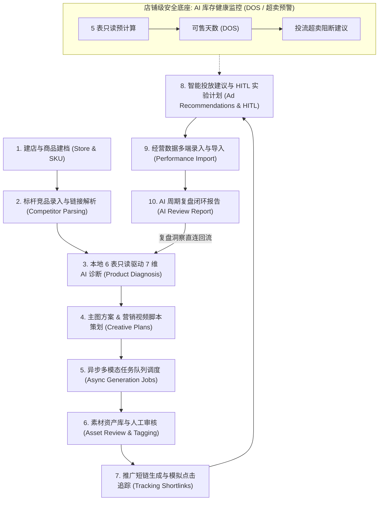

# 电商运营助手 (Ecommerce Operation Assistant - EOA)

<p align="center">
  
  
  
  
  
  
  
  
</p>

---

## 目录 (Table of Contents)

- [1. 项目定位与核心愿景](#1-项目定位与核心愿景)
- [2. 核心架构与 ADR 技术决策](#2-核心架构与-adr-技术决策)
  - [ADR 1: 生产级服务端 Session Cookie 鉴权与 RBAC 权限矩阵](#adr-1-生产级服务端-session-cookie-鉴权与-rbac-权限矩阵)
  - [ADR 2: PostgreSQL 16 异步连接池与 23 张核心实体表](#adr-2-postgresql-16-异步连接池与-23-张核心实体表)
  - [ADR 3: AI 双模引擎 (Mock / Real) 与 Langfuse 全链路可观测](#adr-3-ai-双模引擎-mock--real-与-langfuse-全链路可观测)
  - [ADR 4: Vite envDir 共享配置机制](#adr-4-vite-envdir-共享配置机制)
- [3. 已完整落地的核心业务功能清单](#3-已完整落地的核心业务功能清单)
  - [3.1 店铺概览与 AI 库存健康监控](#31-店铺概览与-ai-库存健康监控)
  - [3.2 导入中心与数据校验](#32-导入中心与数据校验)
  - [3.3 单品 9 大标签页闭环工作台深度解析](#33-单品-9-大标签页闭环工作台深度解析)
- [4. 前端设计与 UI 资产规范](#4-前端设计与-ui-资产规范)
- [5. 生产级部署与 SSL/TLS 网络拓扑](#5-生产级部署与-ssltls-网络拓扑)
- [6. 本地 3 分钟快速起步指南](#6-本地-3-分钟快速起步指南)
- [7. 项目代码组织结构](#7-项目代码组织结构)
- [8. 许可证与贡献指南](#8-许可证与贡献指南)

---

## 1. 项目定位与核心愿景

**电商运营助手 (Ecommerce Operation Assistant - EOA)** 是一套专为中小跨境与国内电商团队量身打造的**单品全生命周期 AI 闭环运营工作台**。

### 核心痛点
1. **多平台割裂**：商品信息在各平台重复录入，竞品数据依赖人工抓取，分析维度脱节。
2. **素材生产成本高昂**：多模态营销素材缺少统一的策划、任务排队与人工审核流水线。
3. **库存与投放脱节**：爆款投放期间频繁发生由于库存断档导致的“超卖退款”与广告预算浪费。
4. **决策缺少数据闭环**：投放与经营复盘数据难以沉淀为模型输入，无法驱动下一轮迭代。

### 核心愿景：单品（Product）为聚合根的 10 步增长飞轮
系统以 **单个商品 (`Product`)** 作为核心聚合根，打通“商品定义 $\rightarrow$ 竞品分析 $\rightarrow$ 智能诊断 $\rightarrow$ 素材生成 $\rightarrow$ 短链追踪 $\rightarrow$ 投放调控 $\rightarrow$ 经营复盘”的全链路闭环：



---

## 2. 核心架构与 ADR 技术决策

本项目遵循 **ASD-STE100 简明工程规范**（短句、主动语态、一词一义），架构实现全部遵循生产级高可用、松耦合原则：

```mermaid
graph TB
    subgraph ClientLayer["客户端接入层 (Client & Gateway)"]
      UserBrowser["现代 Web 浏览器 (Chrome / Safari / Edge)"]
      Nginx["Nginx 1.25+ 反向代理 (TLS 1.3 / HTTP/2 / HSTS / 静态强缓存)"]
    end

    subgraph FrontendApp["前端交互层 (Frontend - Vue 3.5)"]
      ViteApp["Vue 3.5 + TypeScript + Vite + TailwindCSS + Element Plus"]
      PiniaStore["Pinia 会话状态机 (withCredentials: true 自动携带 Cookie)"]
    end

    subgraph BackendApp["后端应用层 (Backend - FastAPI 0.115+)"]
      APIRouter["FastAPI 统一路由网关 (/api/v1)"]
      SessionAuth["服务端 Session Cookie 鉴权与 RBAC (HttpOnly + Lax + Secure)"]
      RulesEngine["本地只读规则引擎 (毛利率 / 竞品均价偏离度 / DOS / 超卖预警)"]
      AIEngine["AI 双模驱动层 (LangChain + LangGraph + with_structured_output)"]
    end

    subgraph InfraLayer["基础设施与外部服务 (Infrastructure)"]
      AsyncPGPool["SQLAlchemy 2.0 Async + asyncpg (复用长连接池)"]
      PostgresDB[("PostgreSQL 16 (pgvector:pg16)\n托管 23 张业务实体表")]
      LangfuseCloud["Langfuse 可观测平台 (链路追溯 / Token消耗 / 延迟审计)"]
      LLMCloud["Qwen / DeepSeek-V4.1-Flash (阿里百炼 / Maas 兼容接口)"]
    end

    UserBrowser -->|443 HTTPS| Nginx
    Nginx -->|SPA 静态文件| ViteApp
    Nginx -->|反向代理 (proxy_buffering off)| APIRouter
    ViteApp --> PiniaStore
    APIRouter --> SessionAuth
    APIRouter --> RulesEngine
    APIRouter --> AIEngine
    AIEngine --> LangfuseCloud
    AIEngine --> LLMCloud
    APIRouter --> AsyncPGPool
    AsyncPGPool --> PostgresDB
```

### ADR 1: 生产级服务端 Session Cookie 鉴权与 RBAC 权限矩阵
- **决策背景**：传统 JWT 存储于客户端 `localStorage` 存在严峻的 XSS 泄漏风险，且服务端难以主动注销吊销。
- **实施方案**：
  - 登录接口 [`POST /api/v1/auth/login`](file:///home/ubuntu/projects/ecommerce_operation_assistant/app/api/v1/routes.py) 校验成功后，通过 `Set-Cookie` 颁发会话凭证。
  - 强制安全标头：`HttpOnly=True`（彻底屏蔽 JavaScript 读取）、`SameSite="lax"`（防御 CSRF 攻击）、`Secure=True/自适应`（开发环境根据协议自适应，生产强制 HTTPS）。
  - **三级角色访问控制 (RBAC Matrix)**：
    | 权限域 / 业务模块 | 管理员 (`admin`) | 运营人员 (`operator`) | 观察人员 (`viewer`) |
    | :--- | :---: | :---: | :---: |
    | 仪表盘、商品档案、数据报表、素材查看 | 允许 | 允许 | 允许 |
    | 商品/SKU/库存调整、竞品解析、经营数据导入 | 允许 | 允许 | **禁止** |
    | AI 诊断、主图/视频策划、异步任务调度 | 允许 | 允许 | **禁止** |
    | **投放建议确认/驳回 (HITL)、A/B 实验状态变更** | **允许** | **允许** | **禁止** |
    | **系统用户管理、角色权限调配、全局系统配置** | **允许** | **禁止** | **禁止** |

### ADR 2: PostgreSQL 16 异步连接池与 23 张核心实体表
- **决策背景**：电商高频读写场景需要极高的并发吞吐能力与强类型约束。
- **实施方案**：
  - 依托 [`app/infrastructure/database.py`](file:///home/ubuntu/projects/ecommerce_operation_assistant/app/infrastructure/database.py)，采用 `SQLAlchemy 2.0 (Async) + asyncpg` 驱动，配置 `pool_size=10, max_overflow=20, pool_pre_ping=True`。
  - FastAPI **Lifespan** 生命周期统一接管，启动时自动建表并预热连接池，优雅停机时统一回收 (`dispose`)。
  - **23 张完整数据模型表清单**（定义于 [`app/models/entities.py`](file:///home/ubuntu/projects/ecommerce_operation_assistant/app/models/entities.py)）：
    1. `User`：系统用户与角色权限表
    2. `Store`：店铺基础档案表
    3. `PlatformAccount`：电商第三方平台授权账号表
    4. `Product`：单品聚合根核心实体表
    5. `PlatformProductMapping`：多平台商品 ID 跨渠道映射表
    6. `ProductSKU`：商品 SKU 规格与定价表
    7. `InventoryItem`：仓储库存现存量与锁定表
    8. `InventoryMovement`：库存出入库与盘点流水变动表
    9. `Competitor`：竞品档案表
    10. `CompetitorMonitor`：竞品自动化监控配置表
    11. `CompetitorMonitorSnapshot`：竞品价格与动态快照历史表
    12. `PublicLinkParseTask`：公开商品链接爬取解析任务表
    13. `ProductDiagnosis`：商品 7 维 AI 诊断报告表
    14. `CreativePlan`：主图与视频营销策划方案表
    15. `GenerationJob`：异步多模态素材生成作业表
    16. `GenerationJobEvent`：作业状态机事件与执行流水审计表
    17. `GeneratedAsset`：生成素材资产库表
    18. `PromotionLink`：营销推广短链主表
    19. `PromotionLinkClick`：短链模拟点击与设备归因日志表
    20. `AdRecommendation`：智能广告投放策略建议表
    21. `AdExperiment`：投放 A/B 实验与调优计划表
    22. `PerformanceRecord`：商品多周期经营数据表现表
    23. `ReviewReport`：AI 经营复盘闭环报告表

### ADR 3: AI 双模引擎 (Mock / Real) 与 Langfuse 全链路可观测
- **架构设计**：
  - 双模自由切换：通过环境变量 `AI_MODE=mock | real` 实现“本地极速离线测试”与“生产真实大模型调用”无缝衔接。
  - **结构化输出约束**：通过 LangChain LCEL 管道与 `with_structured_output` 强制将大模型输出严格绑定为 Pydantic Schema（例如 [`DiagnosisAIOutput`](file:///home/ubuntu/projects/ecommerce_operation_assistant/app/schemas/contracts.py)），杜绝模型幻觉导致的前端解析异常。
  - **智能清洗机制**：内置 `_extract_json_block` 正则过滤器，自动剥离 DeepSeek 系列模型的 `<think>...</think>` 推理思考块，稳定提取纯净 JSON。
  - **全链路观测**：内置 Langfuse 集成（`CallbackHandler`），自动记录每一次 Prompt、Token 消耗、响应延迟及状态机演进轨迹。

### ADR 4: Vite envDir 共享配置机制
- **彻底消除硬编码**：在前端 [`frontend/vite.config.ts`](file:///home/ubuntu/projects/ecommerce_operation_assistant/frontend/vite.config.ts) 中配置 `envDir: rootDir`，使前端 Vite 与后端 FastAPI 共同读取项目根目录下的同一个 [`.env`](file:///home/ubuntu/projects/ecommerce_operation_assistant/.env) 文件。
- 端口自动对齐：前端代理 `/api` 动态读取 `BACKEND_PORT`，杜绝前后端因配置不同步引发的联调问题。

---

## 3. 已完整落地的核心业务功能清单

### 3.1 店铺概览与 AI 库存健康监控
- **本地 5 表只读预计算**：聚合 `products`, `product_skus`, `inventory_items`, `inventory_movements`, `ad_experiments` 数据。
- **DOS 可售天数计算**：
  $$\text{DOS} = \frac{\text{可用库存 (Available Qty)}}{\text{近 7 天出库日均消耗 (Daily Burn Rate)}}$$
- **投放超卖风险智能熔断**：当 SKU 的 $\text{DOS} < 3$ 天且对应商品正在执行 `running` 状态的投放实验时，自动标红 `ad_oversell_risk = True`。
- **AI 补货建议抽屉**：一键生成全店库存健康评分、紧缺 SKU 补货清单（精确至建议补货量）与联动运营建议（暂停投流或降价清仓）。

### 3.2 导入中心与数据校验
- **标准化模板下载**：支持一键导出商品基础信息、SKU 库存、历史经营数据 3 种标准 CSV/Excel 格式。
- **前端拖拽上传与解析**：支持本地拖拽解析，前置拦截缺失必填字段、非法价格、格式异常。
- **容错型部分入库**：遇到非法数据行时高亮提示行号与具体错误，合规行依然能够安全持久化入库，保障业务连续性。

### 3.3 单品 9 大标签页闭环工作台深度解析

在商品详情页中，围绕单品聚合根构建了完整的 9 步闭环流转工作台：

| 标签页 | 业务名称 | 核心驱动数据源与技术实现 | 人工介入点 (HITL) |
| :--- | :--- | :--- | :--- |
| **Tab 1** | **商品 & 竞品** | 维护商品多规格 SKU、库存增减调账（自动生成流水）、多平台映射 ID；录入标杆竞品并触发异步网页解析爬虫。 | 人工核对规格与标杆竞品属性 |
| **Tab 2** | **7 维 AI 诊断** | 本地 6 表只读聚合（本品毛利率、竞品均价偏离度、上轮复盘弱项），大模型输出**定位、价格带、人群、痛点、卖点、风险、建议** 7 维矩阵。 | 运营可对 7 个维度的诊断建议直接在线编辑并保存 |
| **Tab 3** | **主图方案策划** | 读取 Tab 2 诊断卖点，自动规划 3 组具有差异化视觉策略的主图方向（含场景描述与文案 Prompt）。 | 选定主打方向 (`selected`)，调整画面描述 |
| **Tab 4** | **视频脚本生成** | 结合受众痛点与转化诱因，输出 3 组短视频分镜脚本（黄金 3 秒痛点勾子、产品展示、信任背书、行动号召）。 | 审核视频脚本并一键提交渲染任务 |
| **Tab 5** | **异步任务队列** | 针对生图、视频渲染耗时较长的问题，设计异步任务队列。可视化展示任务执行流（`pending` $\rightarrow$ `running` $\rightarrow$ `succeeded` / `failed` / `cancelled` / `timeout`）。 | 支持失败任务一键重试，排队任务手动取消 |
| **Tab 6** | **素材资产库** | 汇聚所有已生成的图片、视频物料，支持多维度过滤、预览原图、标签分组。 | 人工审核打分 (1~5 星) 与审核状态变更 (`approved` / `rejected`) |
| **Tab 7** | **推广短链追踪** | 针对不同投放渠道生成专属 `tracking_code` 推广短链。访问 `/api/v1/r/{code}` 自动记录点击时间、设备指纹并 302 重定向至落地页。 | 运营创建不同渠道的专属追踪参数 |
| **Tab 8** | **投放建议 & 实验** | 本地计算毛利空间与素材储备，输出覆盖渠道、受众、预算、出价模式的投放建议。创建 A/B 实验对比投放效果。 | **严格的人工确认/驳回 (HITL)**，杜绝 AI 自动扣费超支 |
| **Tab 9** | **经营复盘 & 闭环** | 录入或导入实际投放经营数据（消耗、成交量、ROI、CVR）。AI 深度剖析偏差原因与改进措施，**一键同步回流至 Tab 2 诊断**，开启下一轮迭代。 | 经营数据确认与复盘指标验收 |

---

## 4. 前端设计与 UI 资产规范

前端基于 **Vue 3.5 + TailwindCSS + Element Plus** 构建，严格遵循 **极简高端银白色科技风格 (Silver-White Minimalist)**：

1. **色彩系统**：
   - 背景基底：优雅灰白渐变色系（`#F8FAFC` $\rightarrow$ `#F1F5F9`）。
   - 卡片与边框：微发光玻璃拟态边框（`border-slate-200/80`），搭配柔和投影（`shadow-sm hover:shadow-md`）。
   - 交互强调色：科技银蓝（`#3B82F6`）与深邃钛金黑（`#0F172A`）。
2. **矢量设计资产规范 (.pen)**：
   项目在 [`.pen/`](file:///home/ubuntu/projects/ecommerce_operation_assistant/.pen/) 目录下维护了标准的矢量设计规范与设计快照：
   - [`01_login.pen`](file:///home/ubuntu/projects/ecommerce_operation_assistant/.pen/01_login.pen)：现代极简双栏响应式登录页
   - [`02_dashboard.pen`](file:///home/ubuntu/projects/ecommerce_operation_assistant/.pen/02_dashboard.pen)：店铺指标大盘与 AI 库存监控抽屉
   - [`03_import_center.pen`](file:///home/ubuntu/projects/ecommerce_operation_assistant/.pen/03_import_center.pen)：拖拽式数据导入中心与校验提示
   - [`04_product_detail.pen`](file:///home/ubuntu/projects/ecommerce_operation_assistant/.pen/04_product_detail.pen)：单品 9 标签页闭环工作台

---

## 5. 生产级部署与 SSL/TLS 网络拓扑

生产部署配置文件由 [`deploy/nginx/ecommerce.conf`](file:///home/ubuntu/projects/ecommerce_operation_assistant/deploy/nginx/ecommerce.conf) 统一提供：

```
                           [ 客户端浏览器 (HTTPS: 443) ]
                                        │
                                        ▼
                  ┌──────────────────────────────────────────┐
                  │           Nginx 生产反向代理             │
                  │  - HTTP 80 强制 301 重定向至 443         │
                  │  - TLS 1.3 / TLS 1.2 高强加密套件        │
                  │  - HTTP/2 协议多路复用加速               │
                  │  - HSTS (Strict-Transport-Security)      │
                  │  - Gzip 文本静态压缩 (Level 6)           │
                  └─────┬──────────────────────────────┬─────┘
                        │                              │
         / (前端 SPA 静态文件托管)             /api/ (动态后端代理)
                        │                              │
                        ▼                              ▼
            ┌──────────────────────┐       ┌──────────────────────┐
            │  Vite 打包产物目录    │       │   FastAPI 应用服务   │
            │   frontend/dist      │       │ 127.0.0.1:8001 (ASGI)│
            │ - try_files 路由支持 │       │ - X-Forwarded-Proto  │
            │ - 30天静态 Hash 强缓存│       │ - proxy_buffering off│
            │ - index.html 永不缓存│       │ - 300s 超时优化流式  │
            └──────────────────────┘       └──────────────────────┘
```

### 关键网络与安全特性
- **HTTP/2 & 现代加密套件**：启用 `TLSv1.2 TLSv1.3` 与 `ECDHE` 系列高强度加密套件。
- **HSTS 强制保护**：配置 `Strict-Transport-Security "max-age=31536000; includeSubDomains"`，防止降级劫持。
- **AI 流式传输优化**：针对大模型流式输出与长耗时任务，关闭代理缓冲 (`proxy_buffering off;`)，超时时间延长至 `300s`。
- **证书配置方案**：详见部署指引文档 [`deploy/nginx/README.md`](file:///home/ubuntu/projects/ecommerce_operation_assistant/deploy/nginx/README.md)，支持本地开发 `mkcert` 自动化生成授信证书与生产环境 `Certbot (Let's Encrypt)` 自动化续期。

---

## 6. 本地 3 分钟快速起步指南

### 环境准备要求
- **操作系统**：Linux / WSL2 (Ubuntu 22.04 / 24.04 推荐) 或 macOS
- **基础依赖**：Docker & Docker Compose、Python 3.12+、Node.js 20+、[`uv`](https://github.com/astral-sh/uv) (现代化极速 Python 包管理器)

### 步骤 1：克隆项目与配置环境变量
```bash
git clone <repository_url> ecommerce_operation_assistant
cd ecommerce_operation_assistant

# 复制环境变量模板 (已包含预设默认参数)
cp .env.example .env  # 若已有 .env 可跳过，系统会自动按默认配置加载
```

### 步骤 2：启动 PostgreSQL 数据库容器
```bash
# 启动内置的 pgvector/pgvector:pg16 容器
docker compose up -d

# 检查容器运行健康状态
docker compose ps
```

### 步骤 3：安装后端依赖并启动 FastAPI
```bash
# 使用 uv 一键同步虚拟环境与依赖
uv sync

# 启动后端 ASGI 服务 (默认监听 0.0.0.0:8001)
uv run uvicorn app.main:app --host 0.0.0.0 --port 8001 --reload
```
> 后端启动时将通过 Lifespan 自动连接数据库，初始化创建 23 张实体表并自动注册默认系统账号。

### 步骤 4：安装前端依赖并启动开发服务
```bash
cd frontend

# 安装 npm 依赖
npm install

# 启动 Vite 开发服务器 (默认监听 0.0.0.0:5173)
npm run dev
```

### 步骤 5：访问系统与一键生成演示数据
打开浏览器访问前端开发服务：`http://localhost:5173`。

1. **默认预置账号与密码**：
   - **系统管理员 (Admin)**：账号 `admin`，密码 `123456`
   - **运营人员 (Operator)**：账号 `operator`，密码 `123456`
   - **查看人员 (Viewer)**：账号 `viewer`，密码 `123456`
2. **一键生成演示全量数据**：
   登录后进入工作台首页，点击右上角 **「生成演示数据」** 按钮（或直接发起接口调用 `POST http://localhost:8001/api/v1/workspace/demo-data`），系统将自动注入包含：
   - 官方直营旗舰店（含多平台店铺账号）
   - 经典爆款人体工学椅商品档案与 2 款 SKU
   - 历史出入库流水明细与近 7 天销售消耗
   - 2 款行业竞品、价格快照与公开解析任务
   - 7 维 AI 诊断报告、主图与短视频分镜脚本
   - 异步渲染任务事件、素材库资产、推广短链与点击日志
   - 智能投放策略建议、已确认的 A/B 投放实验以及周期复盘报告

### 步骤 6：运行全链路端到端自动化测试
```bash
# 回到项目根目录运行 pytest
uv run pytest -v tests/test_closed_loop_and_ai.py
```
> 测试套件将全量验证：数据库表结构初始化、默认用户创建、Session Cookie 安全属性、Mock 全链路闭环、真实大模型 API 与 Langfuse 链路追踪。

---

## 7. 项目代码组织结构

```
ecommerce_operation_assistant/
├── app/                              # 后端应用核心代码
│   ├── api/                          # HTTP API 路由与依赖注入层
│   │   ├── deps.py                   # 权限鉴权与 Session 依赖项
│   │   └── v1/                       # V1 版本业务端点
│   │       └── routes.py             # 涵盖店铺/商品/AI/短链/任务等全量路由
│   ├── core/                         # 系统核心层
│   │   ├── config.py                 # Pydantic BaseSettings 统一配置管理
│   │   └── security.py               # 密码哈希、Session 加密与安全工具
│   ├── infrastructure/               # 基础设施与连接池
│   │   ├── ai_engine.py              # LangChain + LangGraph + Langfuse 双模编排引擎
│   │   ├── database.py               # SQLAlchemy 2.0 Async + asyncpg 连接池
│   │   └── http_client.py            # 全局异步 HTTP 连接池 (httpx)
│   ├── models/                       # 数据模型层
│   │   └── entities.py               # 23 张业务实体表 (SQLAlchemy ORM)
│   ├── schemas/                      # 数据协议契约层
│   │   └── contracts.py              # Pydantic 请求、响应与 AI 结构化输出契约
│   ├── services/                     # 业务领域服务层
│   │   ├── analyzers.py              # 本地 6 表只读诊断与 5 表库存健康规则引擎
│   │   └── demo_and_jobs.py          # 演示数据灌入、超时巡检与异步任务调度
│   └── main.py                       # FastAPI 实例创建与 Lifespan 生命周期注册
├── deploy/                           # 生产部署与网络配置
│   └── nginx/
│       ├── ecommerce.conf            # Nginx 生产反向代理 (TLS 1.3 / HTTP/2 / HSTS)
│       └── README.md                 # 证书安装与生产运维部署指南
├── docker-compose.yml                # 本地 PostgreSQL 16 (pgvector) 容器编排
├── frontend/                         # 前端单页应用 (Vue 3.5 + TypeScript)
│   ├── index.html                    # 页面入口
│   ├── package.json                  # 前端依赖配置
│   ├── src/
│   │   ├── api.ts                    # Axios 客户端封装 (withCredentials: true)
│   │   ├── App.vue                   # 9 标签页单品闭环工作台与主交互逻辑
│   │   ├── main.ts                   # 前端应用初始化与插件挂载
│   │   └── env.d.ts                  # TypeScript 类型定义
│   └── vite.config.ts                # Vite 配置 (集成 envDir 共享根目录 .env)
├── .Note/                            # 产品需求与架构决策文档
│   └── PRD_与_技术架构选型.md          # 详细需求与 ADR 决策定稿
├── .pen/                             # 矢量界面设计资产与预览快照
├── tests/                            # 自动化测试用例集
│   └── test_closed_loop_and_ai.py    # 全链路闭环与 AI 双模测试
├── pyproject.toml                    # Python 项目元数据与依赖定义
├── uv.lock                           # uv 依赖锁定文件
└── README.md                         # 项目主文档
```

---

## 8. 许可证与贡献指南

- **开源协议**：本项目基于 [MIT License](file:///home/ubuntu/projects/ecommerce_operation_assistant/LICENSE) 开源。
- **欢迎贡献**：欢迎提交 Issue 汇报缺陷或提出功能建议，欢迎发起 Pull Request。提交流程请遵循 Conventional Commits 规范。
